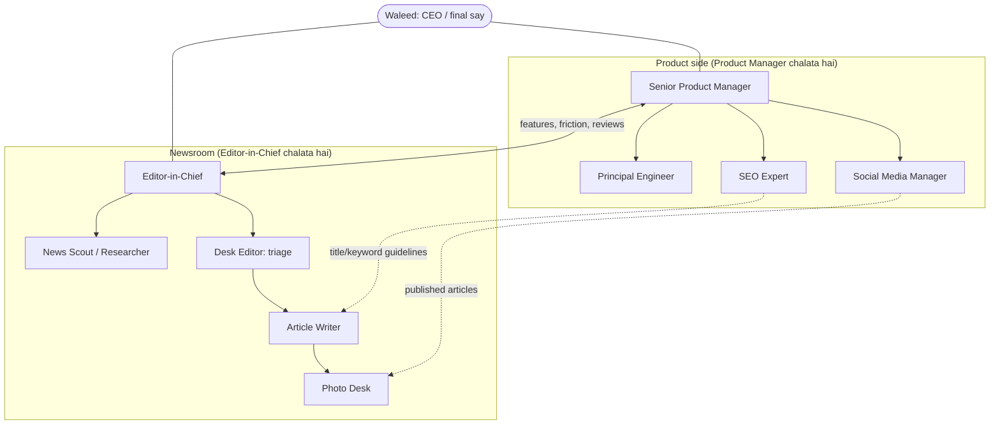
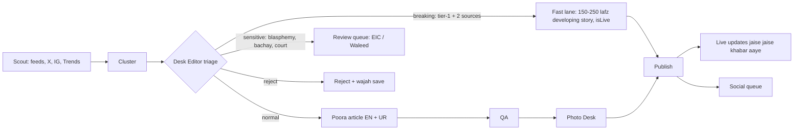
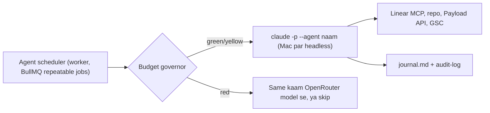
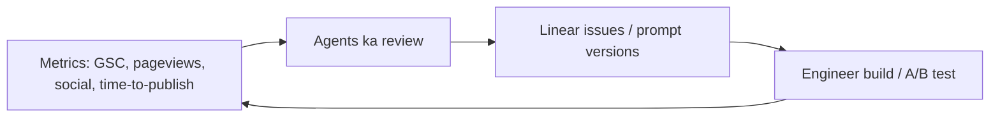

# Zaviya: AI Team aur 24/7 Workflow

> Maqsad: ek aisi newsroom aur product team jo khud chale, khud seekhe, aur sirf zaroori faislon par Waleed se poochhe.
> Status: design (11 Oct 2026). Implementation phases neeche section 10 mein hain.

---

## 1. Bunyadi usool

1. **Do raftar, do engine.** Breaking news minton mein jaati hai, is liye newsroom ka fast lane **kabhi Claude quota ka intezar nahi karega**. Woh maujooda BullMQ worker par chalega (code + Gemini/OpenRouter/local). Claude (Pro $20) sirf "dimagh" wale kaam karega: faisle, review, code, strategy.
2. **AI JSON deta hai, code faisla karta hai.** Yeh [ARCHITECTURE.md](ARCHITECTURE.md) ka usool hai aur qaim rahega. Agents settings aur thresholds badal sakte hain, lekin sirf tay shuda hadood ke andar.
3. **Linear hi daftar hai.** Har agent ka kaam, sawal aur report Linear par hoti hai. Agents aapas mein bhi Linear ke zariye baat karte hain, aur Waleed ko wahin tag karte hain.
4. **Har agent ki apni diary.** `ops/agents/<naam>/journal.md` mein har run ka khulasa likha jata hai. Agla run pehle yeh diary padhta hai, is liye agent ko yaad rehta hai ke pichhli dafa kya kiya tha.
5. **Do sardaar, ek malik.** Product team (build aur growth) aur Newsroom (content) alag hain. Waleed dono ke upar hai.

---

## 2. Team ka naqsha

### Product sab ko manage kare ya koi aur?

Meri salah: **do sardaar.**

- **Product Manager** build side chalata hai: Engineer, SEO aur Social. Features, bugs, growth aur roadmap uske paas hain.
- **Editor-in-Chief (EIC)** newsroom chalata hai: kaun si khabar, kis angle se, kitni jaldi.

Wajah: agar Product khabron ka faisla bhi kare to editorial faisle growth metrics ke peechhe chalne lagte hain (clickbait ka khatra). Doosri wajah: agar PM ka run fail ho jaye ya quota khatam ho, newsroom phir bhi chalta rahega.

Dono ka rishta barabar ka hai:
- EIC, PM se features maang sakta hai (Linear issue, label `from:editor`).
- PM har hafte newsroom ko "user" ki tarah analyze karta hai: kahan time zaya ho raha hai, kaun si khabrein reject hui, kahan editor ne model ka faisla badla. Phir woh cheezein aasan karne ke issues banata hai.

---

## 3. Har agent: kaam, kab chale, kaun sa model

| Agent | Kaam | Kab chale (PKT) | Engine |
|---|---|---|---|
| **News Scout** | Sources poll, cluster, trends, naye sources dhoondhna | Feeds har 2-5 min, X/IG har 20 min | Code + local/Gemini (Claude nahi) |
| **Desk Editor** | Har cluster par triage: publish/review/reject, angle, category | Realtime | Gemini Flash / OpenRouter cheap |
| **Article Writer** | EN + UR article, titles, FAQs, key points | Realtime | Bulk: Gemini / OpenRouter. **Flagship (din ki top 3-5): Claude** |
| **Photo Desk** | Asal tasveer dhoondhna (section 6) | Realtime | Code + Gemini vision check |
| **Editor-in-Chief** | Missed-story audit, homepage lead, corrections, newsroom tuning | Din mein har 60 min (07:00-01:00), raat ko har 3 ghante | Claude |
| **Social Media Manager** | Instagram + X posts, article links, timing | Posting: har 30-45 min (worker). Plan: roz 1 dafa | Posting: code + cheap model. Plan: Claude |
| **SEO Expert** | Search Console, CTR, guidelines, internal links, schema | Roz 10:00, deep audit har Monday | Claude |
| **Product Manager** | Metrics, market research, roadmap, Linear grooming, Waleed se discussion | Roz 09:00 standup + 21:00 review, Sunday strategy | Claude |
| **Principal Engineer** | Linear issues, fixes, features, tests, PR, deploy | Har 2 ghante (jab budget green ho), incident par foran | Claude |
| **Watchdog** | Site, worker, queues, extension ki sehat | Har 1 min | Sirf code |

### 3.1 News Scout + Desk Editor + EIC: khabar ka safar

Speed ka hadaf: **pehle tier-1 source se publish tak 10 minute se kam.**

- **Fast lane:** breaking khabar pehle chhoti "developing" story ke tor par jaati hai (maujooda `isLive` aur `updates` fields). Phir naye sources aane par article khud lamba hota hai. Is tarah Google aur social par hum pehle hote hain.
- **EIC ka ghanta-war run:**
  1. **Missed-story audit:** Dawn, Geo, ARY, BBC Urdu ki top khabrein hamari site se milata hai. Jo reh gayi, unhein wajah ke saath queue mein daalta hai.
  2. **Reject review:** Desk Editor ne jo reject kiya, us mein se 5 random check karta hai. Ghalat reject zyada hon to triage weights ya prompt mein tabdeeli ka issue banata hai.
  3. Homepage lead aur "Breaking" ticker ka faisla.
  4. Corrections: koi factual ghalti mile to correction note ke saath update.
  5. Haftawar: naye sources aur naye areas (cricket, tech, local cities) ki study. Scout ki dhoondhi hui sites ko `enabled=false` se `true` karta hai.

### 3.2 Article Writer

- Har article ko SEO Expert ki guidelines file (`ops/agents/seo/playbook.md`) prompt ke saath milti hai. Is tarah SEO ki seekh har article mein khud shaamil hoti rehti hai.
- Har article ke 3 title variants banti hain (maujooda `titleVariants`), aur SEO Expert CTR dekh kar behtar wali lagata hai.
- Engine routing (section 5): flagship stories Claude se, baqi Gemini/OpenRouter se. Quota kam ho to sab OpenRouter par.

### 3.3 Social Media Manager

- **Posting (worker, har 30-45 min):** naye published articles se Instagram (card/carousel + "link in bio" / story link) aur X (headline + link + 1-2 hashtags). Maujooda `social-posts` collection, daily caps aur idempotency istemal hongi.
- **Rozana plan (Claude, 1 run):** kal kaun sa content kis waqt chala, kaun si posts zyada chali, aaj ke liye timing aur format. Plan `ops/agents/social/plan.json` mein jata hai, aur worker usi ke mutabiq post karta hai.
- **Haftawar:** PM ko report: follower growth, social se site par traffic, kya behtar karna hai.

### 3.4 SEO Expert

- **Roz:** Search Console sync se kam CTR (position 1-10, CTR kam) wale articles ke titles behtar karna, internal links, aur `seo:check` chalana.
- **Haftawar:** poori site ka audit (Core Web Vitals, schema, news sitemap, indexing errors), competitors ki keywords, aur `playbook.md` update. Code ki tabdeeli chahiye to Engineer ke liye Linear issue.

### 3.5 Senior Product Manager

- **09:00 standup:** kal ka traffic, publish count, time-to-publish, errors, agents ki diaries, aur Linear. Aaj ki 3 priorities set karta hai.
- **21:00 review:** din ka khulasa Linear par ek status update ki shakal mein.
- **Sunday strategy:** market research (Pakistani news sites, naye formats, Google Discover trends), roadmap, aur EIC ke saath "newsroom friction" review.
- **Ikhtiyar:** issues banana, priority dena, Engineer ko assign karna, aur settings hadood ke andar badalna. Hadood section 8 mein hain.
- **Discussion:** jab bhi Waleed ki raye chahiye, Linear issue par `needs-waleed` label lagata hai aur comment karta hai: "@Waleed need your input: ..." saath mein 2-3 options aur apni recommendation. Jawab ka intezar karte hue baqi kaam chalta rehta hai.

### 3.6 Principal Engineer

- `Todo` + `agent:engineer` wale Linear issues mein se sab se zaroori uthata hai (ek run mein ek issue).
- Alag git worktree/branch mein kaam karta hai, tests likhta hai, aur `typecheck`, tests, `seo:check` chalata hai.
- PR kholta hai. `risk:low` aur sab checks green hon to khud merge aur deploy karta hai, phir health check chalata hai. Masla aaye to khud rollback karta hai.
- `risk:high` (DB migration, auth, secrets/env, payments, content delete, extension permissions) par PR bana kar `needs-waleed`.
- **Extension update:** extension build karta hai, phir Linear card banata hai: "@Waleed extension v1.x ready: chrome://extensions par reload karein". Waleed reload kar ke card `Done` karta hai, aur Product agle run mein isay dekh leta hai.
- **Incident:** Watchdog site down ya queue stuck dekhe to Engineer ka run foran shuru hota hai (budget reserve se).

---

## 4. Har agent kaise chalta hai (technical)

- **Agent definitions:** `.claude/agents/<naam>.md`: har agent ka role, hadood, tools aur model.
- **Runner:** worker mein naya `agents` queue. Har scheduled job `claude -p` ko agent ke naam, `--max-turns` aur tools ki allowlist ke saath chalata hai, aur nateeja `audit-log` mein save karta hai.
- **Yaad (memory):** `ops/agents/<naam>/journal.md` (pichhle runs), `ops/state/*.json` (shared tez data jaise social plan), aur Linear (lambi baatein).
- **Mac 24/7:** maujooda launchd installer + caffeinate. Claude Code CLI Mac par login hona chahiye (abhi is shell mein `claude` PATH par nahi hai).

---

## 5. Budget governor: $20 Pro plan ka hisaab

Pro plan ki do hadd hain: **5-ghante ki window** aur **haftawar limit**. Claude Code status line ko yeh dono `rate_limits.five_hour.used_percentage` aur `rate_limits.seven_day.used_percentage` ki shakal mein milte hain. Isay save karne ka plan:

1. Ek status line script har response par yeh numbers `~/.zaviya/claude-usage.json` mein likhti hai.
2. Har `claude -p` run ka ledger: kitne turns, kitna waqt, aur kya rate-limit error aaya.
3. Rate-limit error aaye to governor foran **red** maan leta hai, jab tak `resets_at` guzar na jaye.

> Note: yeh field community docs mein hai, official guarantee nahi. Concurrent sessions mein number thoda purana ho sakta hai. Phase 0 mein asal JSON check karna hai; agar headless runs mein yeh na mile to sirf ledger + error detection par chalenge.

### Haalat aur rules

| Haalat | Shart | Kya chalega |
|---|---|---|
| 🟢 Green | 5h window mein 50% se zyada bacha, aur hafte mein 25% se zyada | Sab Claude agents + flagship writing |
| 🟡 Yellow | 5h mein 10-50% bacha | Sirf EIC, incident Engineer aur PM standup. Writing OpenRouter par |
| 🔴 Red | 5h mein 10% se kam, **ya** hafte mein 15% se kam | Koi Claude nahi. Writing aur zaroori runs OpenRouter par, baqi agle window tak ruk jate hain |

### Haftawar quota ka batwara (shuruati andaza, PM har hafte badlega)

| Agent | Hissa |
|---|---|
| Principal Engineer | 35% |
| Editor-in-Chief | 20% |
| Product Manager | 15% |
| Flagship writing | 12% |
| SEO Expert | 10% |
| Social plan | 3% |
| Incident reserve | 5% |

**Seedhi baat:** $20 Pro ki limit chhoti hai. 24 ghante ki saari writing Claude par nahi chal sakti. Is liye Claude ko wahan lagaya hai jahan uska faida sab se zyada hai (faisle aur code), aur alfaaz ka bulk Gemini free + OpenRouter par hai. Agar baad mein dekha ke Engineer ya EIC ko zyada quota chahiye to Max plan ya API key ka faisla PM `needs-waleed` ke zariye poochhega.

Default model: sab agents ke liye Sonnet (quota mein sasta). Opus sirf Sunday strategy aur mushkil engineering issues ke liye, aur sirf green haalat mein.

**OpenRouter:** maujooda router mein `api:` provider pehle se hai, is liye OpenRouter key aur model `.env` mein daalna kaafi hai. Mahine ka spending cap OpenRouter dashboard par lagana zaroori hai.

---

## 6. Tasveerein: asal photos, AI ki jaali "photo" nahi

Aap ka idea tha ke Google ki pehli 2-3 photos utha kar Gemini se waisi "real" photo banwayein. **Main yeh nahi karne ki salah doonga:**

- **Copyright:** news photos (AFP, Reuters, Dawn, Geo) unki property hain. Unhein reference bana kar milti julti tasveer banana bhi derivative kaam hai.
- **Jaali khabar ka khatra:** kisi asal waqiye ya asal shakhs ki AI "photo" ek fabricated news photo hai. PECA (2025 amendment) mein fake news par saza hai. Google News/Discover manipulated media par site ko gira sakte hain, aur ek pakdi gayi fake photo site ki credibility khatam kar deti hai.

Yeh ladder **zyada real** tasveer deta hai, aur legal bhi hai:

| # | Source | Kab | License field |
|---|---|---|---|
| 1 | **Official handouts**: PID, ISPR, PM Office, provincial DGPR, PCB, company press releases | Hukumati / official khabrein | `handout` + credit |
| 2 | **Wikimedia Commons**: asal photos (siyasatdan, imaratein, shehar, stadium) | Kisi shakhs ya jagah ki khabar | `wikimedia` + attribution |
| 3 | **Unsplash / Pexels**: free real photos (petrol pump, currency, sona, class room, traffic) | Rates, business, aam khabrein | `stock` + credit |
| 4 | **Apni library**: pehle istemal hui tasveerein, tags ke saath | Ek hi topic baar baar | jo pehle tha |
| 5 | **AI photoreal, sirf aam manzar**: koi asal shakhs ya waqiya nahi. Reference ke tor par licensed stock photo | Jab 1-4 se kuch na mile | `ai-generated` + site par label |

- Photo Desk har tasveer ko Gemini vision se check karega: kya khabar se mutabiqat hai, watermark to nahi, aur chehra ghalat shakhs ka to nahi.
- Articles ke andar asal X/Instagram posts ka **embed** pehle ki tarah chalta rahega. Embed legal hai aur asal tasveer dikhata hai.
- Maujooda illustration wala rasta (media.ts `heroPrompt`) sirf aakhri fallback ke tor par rahega.

---

## 7. Linear setup

**Team:** Zaviya. **Projects:** Newsroom, Product, Engineering, SEO, Social.

**Labels:**
- Agent: `agent:product`, `agent:engineer`, `agent:seo`, `agent:social`, `agent:editor`, `agent:scout`
- Kahan se aaya: `from:editor`, `from:product`, `from:seo`, `from:social`, `from:watchdog`
- Faisla: `needs-waleed`, `risk:low`, `risk:high`
- Qisam: `bug`, `feature`, `research`, `incident`

**Statuses:** Triage → Todo (PM approved) → In Progress → In Review (PR) → Waiting on Waleed → Done

**Waleed ko tag karna:** agents ek alag Linear **bot user / API key** ("Zaviya Agents") se chalein. Agar agents Waleed ke apne account se chalein to apne aap ko tag karne par notification nahi aati.

**Rozana flow:**
1. Agents issues banate hain (`Triage`).
2. PM 09:00 par triage karta hai: priority, label, assign, `Todo`.
3. Engineer `Todo` + `agent:engineer` uthata hai.
4. Jahan Waleed ki zaroorat ho: `needs-waleed` + comment. Waleed jawab de ya card move kare, aur agla run usay padh leta hai.

---

## 8. Ikhtiyar aur hadood (guardrails)

| Kaam | Kaun kar sakta hai | Waleed ki manzoori? |
|---|---|---|
| Issue banana / priority | PM, EIC, SEO, Social | Nahi |
| Triage threshold badalna | EIC (±0.05, hafte mein ek dafa) | Is se zyada ho to haan |
| Daily social caps | PM / Social (±30%) | Is se zyada ho to haan |
| Prompt badalna | PM / EIC / SEO, `prompt-versions` mein naya version + A/B | Nahi |
| Code merge (`risk:low`, sab checks green) | Engineer | Nahi |
| Code merge (`risk:high`) | Engineer PR banata hai | **Haan** |
| Paisa kharch, naya account, tokens, domain | Koi agent nahi | **Hamesha Waleed khud** |
| Content delete / retract | EIC sirf `retracted` (delete nahi) | Delete ke liye haan |
| Kill switch | Watchdog, EIC, Waleed | Nahi (sirf rokna) |

Har agent ka har action `audit-log` mein `actor: agent:<naam>` ke saath jata hai.

---

## 9. Khud ko behtar karne ka loop

- **Roz:** SEO titles, social timing, triage weights (maujooda `learning.ts`).
- **Haftawar retro (Sunday, PM):** har agent ki diary + metrics. Kya chala, kya nahi, aur agle hafte ka quota batwara.
- **EIC ↔ PM:** newsroom ki takleefein → product features. Product ke naye tools → newsroom ka kaam aasan.

---

## 10. Implementation phases

| Phase | Kya banega | Nateeja |
|---|---|---|
| **0: Bunyad** | Linear team, labels, bot user. `.claude/agents/*.md` (8 agents). Worker mein `agents` queue + runner. Budget governor + usage file. `ops/agents/*/journal.md` | Agents schedule par chal sakte hain |
| **1: Newsroom** | Breaking fast lane + live updates. EIC run. Photo Desk ka real-image ladder. Writer ki Claude/OpenRouter routing | Tez aur behtar khabrein, asal tasveerein |
| **2: Growth** | Social Manager (IG + X plan/posting). SEO Expert + playbook | Social traffic, CTR mein behtari |
| **3: Product loop** | PM standup/review/strategy. Engineer ka Linear → PR → deploy, auto-merge `risk:low` | Site khud behtar hoti rahe |
| **4: Seekhna** | Haftawar retro, prompt A/B, quota ka khud batwara | Har hafta pichhle se behtar |

---

## 11. Waleed ke faisle (shuru karne se pehle)

1. **Tasveerein:** section 6 ka real-image ladder manzoor? (Recommendation: haan.)
2. **Linear bot user** banana (taake tag ki notification aaye).
3. **OpenRouter** key aur mahana cap (misaal: $10-15).
4. **Auto-merge:** `risk:low` PRs Engineer khud merge aur deploy kar sake? (Recommendation: haan, health check aur auto-rollback ke saath.)
